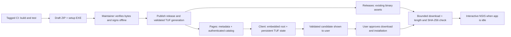

# ADR: authenticated updates with side-by-side installation

Status: proposed architecture, 2026-10-11; documentation only. Requirements were
accepted in PR #12. No updater, signing key or publication infrastructure is deployed.
Scope: Windows x64 installed builds; portable/source builds receive notifications
and a manual download handoff. See [requirements](reporting-and-updates.md).

## Decision

Use The Update Framework (TUF) to authenticate a small release catalog hosted on
GitHub Pages. Download packages from the existing GitHub Releases assets. Keep the
current per-user, versioned NSIS installer as the installation mechanism. Checking,
downloading and installation are separate capabilities with separate user actions.

Prefer the Rust `tough` client and `tuftool` publisher, subject to a pinned-version
compatibility/security spike. Use standard TUF Ed25519 metadata, not a custom signature
format or a separate minisign layer. TUF authenticates the catalog; the catalog binds
each package's exact byte length and SHA-256. The package downloader verifies both.

This adds one small metadata repository, not a server, service, scheduler on user
machines or executable-replacement helper. The offline signing step fits the existing
manual release approval. All selected tooling is open source; no paid installer,
hosting plan or Authenticode purchase is required by this design.

## Why this shape fits the project

The current app has one media/dependency worker; update network work must not occupy
it. NSIS already installs into a distinct version directory and refuses collisions.
Replacing a running executable would discard this useful boundary and introduce
Windows file-lock, rollback and cleanup machinery. Installing alongside the current
version keeps it available after a failed update without needing rollback code.

A detached minisign signature is simpler initially, but leaves freshness, persisted
version history, key rotation and recovery policy to our implementation. TUF provides
a specified metadata trust workflow for these concerns. Its operating cost is real:
expiring metadata needs renewal. We accept that cost explicitly instead of claiming
that an adjacent checksum or a signature alone solves update security.

| Candidate | Assessment |
| --- | --- |
| GitHub API plus checksum | Useful for manual discovery; repository-hosted hashes alone do not separate signing trust from hosting compromise. |
| `self_update` in-place updater | Its primary abstraction updates executable files; our supported artifact includes notices and an NSIS installation contract. Do not use it as the installation owner. |
| Custom JSON plus minisign | Mature signature tooling, but requires our own freshness/rotation protocol; retain as a fallback for reassessment, not a parallel implementation. |
| TUF catalog plus existing NSIS | Recommended: standard trust protocol, small product policy layer, no second installer. |
| Service, MSIX migration or delta updater | Adds installation/privilege/operational scope without solving a demonstrated need in this small beta. |

## Trust and publication boundaries



TUF uses root, targets, snapshot and timestamp roles with distinct responsibilities.
Ship an initial trusted root in the app; persist verified metadata between launches.
Never disable expiry enforcement. Retain versioned roots so old clients can follow
the standard rotation chain. These are framework responsibilities, not new app crypto.

Threats addressed: untrusted HTTP/API content, changed packages, mismatched catalog
generations, replay of already-observed metadata and stale metadata beyond its
validity window. Availability is not guaranteed: a host can withhold updates. A new
client can see an older still-valid generation; signatures cannot prove that it is
the newest. Persisted state and expiration bound this risk, rather than eliminating it.

Initial trust still depends on obtaining the first application from a trusted source.
An authorized targets signer can authorize malicious packages; a compromised build
can produce malicious bytes that pass tests. TUF does not attest code quality or fix
that supply-chain boundary. Compromised same-user processes, altered local settings,
deleted trust state and hostile administrators remain outside the current threat model.

## Catalog and transport

Expose `/timestamp-cleaner/updates/metadata/` and `/updates/targets/` through the
existing Pages deployment. TUF's target is `catalog-v1.json`; its immutable,
content-addressed copies follow the selected tool's consistent-snapshot convention.
Only the small catalog is a TUF target. Packages remain Releases assets, so no custom
TUF transport mapping or second copy of every binary is required.

Catalog v1 is an application schema, not a crypto protocol. It contains a bounded
list of currently offered releases with: exact semver, channel, tag, source commit,
target triple, artifact kind, basename, byte length, package SHA-256 and installed
application SHA-256 obtained from the verified ZIP manifest. Include a schema
version and product identifier. Do not accept install paths, executable arguments,
commands, arbitrary download URLs or arbitrary notes HTML from it. Release-note links
and download URLs are derived from fixed repository constants and validated tags.

The verifier rejects duplicate version/target/kind entries, unknown schema versions,
invalid names/hashes, unsupported targets and tags inconsistent with versions. The
signed catalog is authoritative for executable updates. GitHub release metadata is
not a second source of trusted candidates; it is used by the publisher to construct
the catalog and by users for release notes. Public-but-unpromoted releases are not
offered automatically. Missing/deleted assets cause an unavailable update, not fallback
to an unverified URL. Withdrawal requires publishing a newer signed catalog.

Only offer semantically newer versions. Stable channel excludes prereleases; beta
channel includes beta and stable versions. Channel switching never permits a downgrade.
Use parsed semver ordering, including numeric beta identifiers. Publication dates and
GitHub's latest-release flag do not select versions. The release policy currently
accepts beta tags only; supporting stable publication needs a separate policy change.

Metadata requests go only to the fixed Pages origin with HTTPS and no redirects.
Asset requests start at the derived fixed GitHub Releases URL; allow only explicitly
tested GitHub asset redirect hosts, HTTPS, standard ports and at most three hops.
Reject userinfo, IP literals, unknown hosts, downgrade redirects and credential forwarding.
Disable cookies, ambient credentials and automatic decompression of binary responses.
Corporate TLS/proxy support must preserve certificate verification; no bypass setting.

Initial limits to validate in the spike: catalog 256 KiB, each metadata file 1 MiB,
64 catalog entries, 32 root rotations per attempt, package 256 MiB, 10-second connect,
30-second check and 15-minute download deadline. Enforce limits on streamed bytes,
including responses without Content-Length. Root catch-up beyond the attempt limit
persists verified progress and requires an explicit retry; never skip intermediate roots.

## Rust boundaries and state

Keep a small `updates` module separate from media errors and `installer.rs` (which
currently installs FFmpeg through WinGet). Proposed internal owners are policy,
repository verification, download and Windows handoff. Avoid a plugin system or
generic installer framework; only platform handoff needs a platform boundary.

Policy accepts typed installed version, channel, target and installation identity.
Repository verification produces `VerifiedCatalog`; policy produces `UpdateCandidate`;
hash/length verification produces `VerifiedPackage`. Constructors are private to the
appropriate module. The Windows handoff cannot accept an arbitrary path or raw URL.
Closed enums represent channel, package kind, failure category and update state.
Consume the entire TUF target stream successfully before parsing or exposing catalog
data: `tough` documents that streamed bytes arrive before final checksum validation.
An error at EOF must discard the candidate, not leave a partially trusted catalog.

Use one update worker with a bounded message channel and cancellation, independent
of the existing media worker. If `tough` requires Tokio, own one small runtime on that
worker rather than converting the video/UI pipeline to async. No updater singleton,
periodic polling loop or thread per request. Persisted TUF state needs a cross-process
lock; if unavailable, defer the check. Never reset a damaged datastore to the embedded
root silently: automatic installation stays disabled until explicit recovery.

```text
Disabled / Idle -> Checking -> Current / Available / CheckFailed
Available --approval--> Downloading -> Ready / DownloadFailed
Ready --idle + approval--> Installing -> Installed / InstallFailed
```

If the first approval explicitly covers both download and immediate installation,
it remains valid only for that candidate and the current idle session. If work begins,
the app restarts, the candidate changes or the package is deferred, ask again before
installation. Re-check freshness and candidate eligibility immediately before handoff.
Do not turn a signed-but-withdrawn cached candidate into an offline executable update.

The first-run UI explains that checks contact GitHub, revealing normal network data
such as IP and app User-Agent; ask once to enable daily automatic checks. A manual
check works without enabling automatic checks. On each later launch, check when due;
no background work runs while the app is closed. Failures are non-modal and never
disable media processing. Persist last automatic attempt before starting network work;
manual retries are explicit. Clock rollback produces a visible clock/settings problem,
not expiration bypass or an unbounded retry loop.

Store versioned preferences and TUF state outside versioned application directories
under per-user local application data. Separate preferences from trust state; resetting
preferences must not reset rollback history. Atomic settings writes use an exclusive
temporary sibling, flush and replacement with a lock. A future shared settings schema
must preserve unknown fields or refuse incompatible writes across installed versions.
Channel, skipped version and automatic-check preference persist; local errors contain
bounded categories and never transmit family-media paths or telemetry.

## Windows handoff and recovery

NSIS will write an installation identity/completion marker last, after payload,
shortcut and registry operations succeed, and remove it during exact-file uninstall.
Require matching product/version/target, canonical fixed directory, application path
and HKCU registration to select installed mode. The marker distinguishes packaging,
not a security boundary against hostile same-user code. Ambiguous/copied/source builds
receive portable mode. Existing beta.2 lacks the marker and cannot gain update code
retroactively; users manually install the first updater-capable version once.

Stream the chosen setup into a private, exclusively created per-user staging directory;
do not buffer it in memory, resume partial downloads or execute partial files. Verify
length and SHA-256, then recheck before `Command` launches the absolute setup path with
fixed arguments and a controlled working directory. No shell, elevation or user-supplied
arguments. Protection from a malicious same-user process racing file replacement is
outside this design's stated boundary; do not claim Windows path-based execution is
immune to that race. Keep the verified package alive until setup exits.

Launch interactive NSIS only while all application jobs are idle; reserve that state
against new jobs until setup finishes. Keep the old GUI running: separate directories
mean it need not exit before installation. Monitor the child without blocking egui.
Once setup is running, do not kill it on Cancel or a network-style timeout; installation
cancellation belongs to NSIS. Closing the old app does not cancel or roll back setup.

Successful process creation or exit code alone is insufficient. Require successful
exit plus the target completion marker, fixed-location registration and expected new
application hash from the authenticated catalog.
Partial folders remain incomplete and follow existing documented recovery. Do not
delete them recursively, remove older versions, or claim NSIS is transactional.

Show **Installed: open new version** only after these checks. User-triggered launch
uses the verified fixed application path; keep the old app usable if launch fails.
Spawning does not establish application health. No automatic project/state transfer
is claimed. Setup never downloads prerequisites; the new app retains normal dependency
discovery. A previous-version shortcut remains available for manual recovery.

Portable builds offer the official release page and ZIP instructions. Automatic ZIP
extraction/replacement, Linux packages, delta patches, forced updates, background
services, automatic old-version removal and unattended restarts are outside v1.

## Feasibility and acceptance gates

Before selecting a dependency version, spike `tough`/`tuftool` against Rust 1.92,
Windows/Linux CI, Apache policy, dependency audit, persistent root/metadata handling,
transport limits and cancellation. Confirm whether updated roots require explicit
application persistence; do not assume the datastore saves every trust artifact.
Measure release binary growth, startup overhead and idle worker memory. No crate has
been added and no compatibility, cryptographic integration or runtime benchmark has
been established by this ADR.

Required tests: deterministic clock/network/filesystem policy tests; beta.9/beta.10
and stable promotion; altered packages/catalogs; wrong/rotated/revoked keys; rollback,
expiry and mixed generations; wrong architecture; missing assets; redirect abuse;
bounded malformed/chunked responses; cancellation and disk-full; shared-state locking;
skipped versions and disabled checks; media-job/install mutual exclusion. Use the
standard verifier with real signed fixtures, not a mock that always approves metadata.

Disposable Windows tests must upgrade between two distinct fixture versions, leave
the old version intact on failure, reject copied markers, observe partial-install
recovery, preserve user files, and verify post-install identity. Desktop/clean-host,
screen-reader/high-DPI and prerequisite-recovery checks remain manual release gates.
An unavailable or expired update repository must leave the video app working.

## Sources and related documents

- [TUF specification](https://theupdateframework.github.io/specification/latest/): role separation, metadata verification and expiry/rotation rules.
- [tough and tuftool](https://github.com/awslabs/tough), [RepositoryLoader](https://docs.rs/tough/latest/tough/struct.RepositoryLoader.html): Rust verification/publishing and persistent datastore settings.
- [Minisign](https://jedisct1.github.io/minisign/) and [self_update](https://docs.rs/self_update/latest/self_update/): evaluated alternatives, not dependencies selected here.
- [Operations and release integration](auto-update-operations.md), [NSIS contract](windows-installer.md), [security model](../SECURITY.md).
